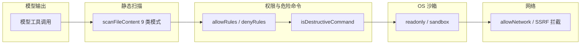

# 安全模型

FreeSeek 是一个能读写文件、执行命令的 Agent 编程助手，安全采用
**分层防御**：内容扫描 → 权限规则 → 危险命令拦截 → OS 沙箱 → 网络隔离。
本文件描述各层模型，以及如何报告漏洞。

## 分层防护总览

## 1. 文件内容静态扫描（L1）

所有文件编辑内容（`write_file` / `edit_file`）在落盘前经过
`src/hooks.ts scanFileContent` 的静态安全扫描，覆盖 9 类危险模式
（如恶意脚本注入、路径穿越、敏感文件写入等），命中即阻断。

## 2. 权限规则（L2）

- **`freesek.denyRules`**：正则数组，对「工具名 + 参数 JSON」做匹配，命中则硬阻断。
  优先级最高，示例：`["^run_command .*rm -rf", "^write_file .*\\.env"]`。
- **`freesek.allowRules`**：正则数组，命中则跳过危险命令硬阻断并直接放行，
  示例：`["^run_command .*npm test", "^read_file"]`。
- **`freesek.confirmFileWrites`**：开启后每次写文件弹权限确认框（允许/总是允许/拒绝/总是拒绝）。
- **Plan/只读守卫**：`verify` / `delete_file` 等纳入统一 Plan/只读守卫，
  在 plan 模式或只读子代理中不可执行。

## 3. 危险命令拦截（L2）

`src/sandbox.ts isDestructiveCommand` 与 `src/hooks.ts DANGEROUS_PATTERNS`
两份清单（保持风格一致）拦截灾难性命令，例如：`rm -rf`、`format`、`shutdown`、
`mkfs`、`dd` 等破坏性操作。**off 档也必须防灾难性命令**——即使沙箱关闭，
L2 拦截仍然生效。

## 4. OS 沙箱（L3，`freesek.sandboxMode`）

| 档位 | 行为 |
| --- | --- |
| `off` | 原样执行（仅依赖 L2 危险命令拦截） |
| `readonly` | 完全禁止 `run_command`（最保守） |
| `sandbox` | OS 级沙箱：macOS 用 sandbox-exec(Seatbelt)、Linux/WSL2 用 bubblewrap(bwrap)，内核级强制文件/网络隔离 + 进程级 env 过滤兜底 |

> ⚠️ **Windows 无原生 OS 沙箱**，`sandbox` 档会软降级为「进程级受限执行」并
> 告警（可借 Docker Desktop 获得容器级隔离）。`freesek.sandboxFailIfUnavailable`
> 设为 `true` 时，沙箱引擎缺失会被安全网关**硬拦截**（托管部署安全闸门）。

沙箱档的网络出网策略由 `freesek.sandboxNetwork` 控制：
`off`（完全禁网，默认最安全）/ `localhost`（仅允许 localhost 绑定，供 dev
server）/ `allow`（放开）。

## 5. 网络隔离（L4）

- **SSRF 防护**：`web_fetch` 与 HTTP 连接器拦截内网地址（127.0.0.1、局域网、
  link-local 等），防止服务端请求伪造攻击内部资源。
- **`freesek.allowNetwork`**：默认开启联网（`web_search` / `web_fetch`），
  设为 `false` 可彻底禁用 Agent 联网（沙箱/敏感环境）。联网是纯 HTTP 请求，
  与 `allowShell` 独立。

## 6. 外部服务审批

- **MCP 工具审批**：外部 MCP 工具首次调用时弹窗询问「允许 / 允许本次 / 拒绝」，
  会话级记录 allow，拒绝则不执行。
- **MCP resources/prompts**：走用户审批；子代理继承 MCP 审批回调。
- **Slash 指令审核**：执行自定义 `.md` 命令前弹窗让用户审核确认（命令可能含危险操作）。

## 7. 数据完整性

- **外部修改冲突检测**：文件指纹（mtime+size+sha1 快照）；若文件在 FreeSeek
  上次读/写之后被外部改动，写/编辑会拒绝并提示，可加 `force: true` 强制覆盖。
- **Checkpoint**：`freesek.autoCheckpoint` 开启时，写文件前自动 git stash
  检查点（最多 15 个），可用 `rewind` 工具回滚。
- **Safe-Delete**：`delete_file` 转系统回收站，可恢复（Windows/macOS/Linux 跨平台）。

## 8. Webview 安全

- **CSP**：webview 设置 Content-Security-Policy（nonce 脚本 + 资源白名单）。
- **XSS 防护**：markdown 用 DOMPurify 净化后再渲染。
- **沙箱 webview**：`window.prompt` / `window.confirm` 被禁用（这也是扩展内
  改用自定义输入框/确认框的原因）。

## 9. 密钥与凭据

- API Key 支持 `${env:VAR}` 插值，避免明文写入配置；也可用
  `${setting:freesek.xxx}` 引用 VS Code 设置。
- `freesek.debugVerbose` 会打印完整请求体（可能含对话内容），仅在排障时开启。

## 报告漏洞

请勿在公开渠道（Issue / 讨论）发布未修复的安全漏洞细节。请通过以下方式私密报告：

1. **邮件**：在 GitHub 仓库（发布后）的 Security → Advisories 提交私密漏洞报告。
2. **Issue**：若仓库尚未开放 Private Vulnerability Reporting，请发 Issue 并在标题
   前缀 `[SECURITY]`，说明影响面与复现步骤，不要附完整 payload。

我们会尽力在 72 小时内响应，确认漏洞后优先修复并发布补丁版本。

## 安全改动纪律（对维护者）

新增工具/命令时，必须同时更新：

- `src/sandbox.ts isDestructiveCommand` 与 `src/hooks.ts DANGEROUS_PATTERNS`
  两份清单（保持一致风格）。
- 文件编辑内容的静态安全扫描集中在 `src/hooks.ts scanFileContent`（9 类模式），
  新增模式加在那里。

详见 [CONTRIBUTING.md](CONTRIBUTING.md)。
