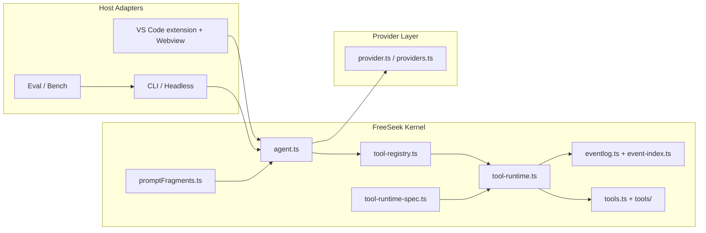

# 架构与源码模块职责

FreeSeek 0.18 是**宿主无关的 Agent Kernel + 多宿主适配层**。VS Code Webview 是主交互客户端，CLI/Headless 是正式的终端/CI 宿主；Eval/Bench 复用 Headless 运行链。
整体分层：**Host Adapter → Agent Kernel → Tool Runtime / EventLog → Provider**。

## 整体数据流

## 源码模块职责

### 宿主核心（src/）

| 模块 | 职责 |
| --- | --- |
| `extension.ts` | VS Code 宿主：Webview 生命周期、UI/会话管理、prompt 组装调度 |
| `cli.ts` | 统一终端入口：run/eval/bench/doctor/sessions/replay；仅做 host routing / local inspection，不旁路 Kernel |
| `headless.ts` | 无 VS Code runtime 的 Coding Agent host；resume/fork/审批/能力开关 |
| `eval-cli.ts` / `bench-cli.ts` | Eval/Bench CLI 适配层，复用 Headless Kernel |
| `activate.ts` | 激活流程装配（命令注册、上下文注入） |
| `agent.ts` | 模型/Agent 主循环（ReAct 推理、maxSteps 预算、工具调度与结果回灌） |
| `tool-runtime.ts` | **统一工具 Runtime**：模式/能力准入 → 权限规则 → 审批 → hooks → cancel/timeout → body → post → 截断 |
| `tool-runtime-spec.ts` | 宿主执行元数据（effect/approval/concurrency/capability/timeout），与模型 ToolDefinition 分离 |
| `agent-subagent.ts` | 子代理执行 `runSubAgent` + frontmatter 解析 + 权限派生 |
| `agent-registry.ts` | 子代理注册表 / 忙态集合 |
| `agent-types.ts` | 子代理句柄与回调类型 |
| `agent-utils.ts` | Agent 辅助纯函数 |
| `tools.ts` | 工具 body 与共享 ToolContext；raw `executeToolBody` 仅允许 ToolRuntime 调用 |
| `tools/defs.ts` | 工具定义常量（名称/描述/schema） |
| `tools/fs_utils.ts` | 文件工具辅助（编码、指纹、路径） |
| `tools/exec_code.ts` | `run_python` / 代码执行器 |
| `tools/verify.ts` | 质量门禁工具（typecheck/lint/test） |
| `tools/web.ts` | 联网检索工具（web_search / web_fetch） |
| `provider.ts` | SSE 流解析（claude/gemini/openai 行格式）与 chat body 组装 |
| `providers.ts` | Provider 配置管理、模型发现、请求构造 |
| `promptFragments.ts` | **系统提示词组装**：`assembleBoundedFragments` 片段上限/总量硬上限、关键协议永不被截断 |
| `prompts.ts` | 各角色系统提示词模板 |
| `rolePresets.ts` | 子代理角色预设（explore/plan/verify/general + description/skills） |
| `sandbox.ts` | 命令执行与沙箱（危险命令拦截、OS 沙箱包装、超时、输出上限） |
| `hooks.ts` | 安全钩子：权限规则（allow/deny）、文件内容静态扫描（9 类模式）、MCP 审批 |
| `dangerous.ts` | 危险命令模式清单 |
| `context.ts` | 三级上下文压缩（Layer 预算、preCompactHook 锚定 goal） |
| `skills.ts` | 技能系统（内置技能、目录扫描、依赖排序、setStatus） |
| `hookify.ts` | 可编程规则（hook 事件/动作） |
| `goal.ts` | 目标状态机（create/edit/pause/resume/complete/block/clear + 轮次预算） |
| `jobs.ts` | 后台任务注册表（job_list/job_output/job_kill） |
| `eventlog.ts` | 会话事件日志（回放/排查、会话标题投影） |
| `memory.ts` | 自动记忆（remember） |
| `mcp.ts` | MCP client（stdio/http、工具注入、resources/prompts、审批） |
| `connectors.ts` | 连接器插件抽象（registerConnector / dispatchConnectorTool） |
| `connectors/http.ts` | 通用 HTTP 连接器 |
| `connectors/paper_seek.ts` | PaperSeek 学术检索连接器 |
| `worktree.ts` | git worktree 并行隔离 |
| `wsdiff.ts` | 行级 unified diff 实现 |
| `lsp.ts` | LSP 语义索引辅助 |
| `browser.ts` / `cdp.ts` | browser 工具（CDP 控制真实浏览器） |
| `encoding.ts` | 文件编码探测（BOM→UTF-8→gb18030/big5/shift_jis/euc-kr 回退） |
| `freeserver.ts` | 免费服务管理（deepseek-free-api 启停/检测） |
| `storage.ts` | 路径 / 索引 / 会话持久化 |
| `importer.ts` | 导入 Codex / Claude Code 对话 |
| `chitchat.ts` | 闲聊兜底 |
| `pricing.ts` | token 定价估算 |
| `rules.ts` | 权限规则引擎 |
| `commands.ts` | 命令注册 |
| `debug.ts` | 调试输出（FreeSeek Debug 通道） |

### Webview 前端（src/webview/）

| 模块 | 职责 |
| --- | --- |
| `main.ts` | 前端入口、消息路由、渲染调度 |
| `state.ts` | 前端状态管理 |
| `components.ts` | 组件层聚合出口（纯 re-export） |
| `components-base.ts` | 基础元素/工具（含 addActionBar） |
| `components-round.ts` | 对话回合渲染 |
| `components-cards.ts` | 工具调用卡片 / diff 卡片 |
| `components-panels.ts` | 任务列表 / 文件列表 / 当前目标常驻面板 |
| `components-modals.ts` | 弹窗 modal（添加提供商表单等） |
| `components-dialogs.ts` | 自定义输入框 / 确认框（webview 沙箱禁用原生 prompt/confirm） |
| `components-sidebar.ts` | 侧边栏（会话树分组、归档、技能管理） |
| `components-modelmenu.ts` | 模型下拉菜单 |
| `components-provider.ts` | 提供商管理 UI |
| `components-settings.ts` | 设置面板（含 MCP 管理） |
| `components-autocomplete.ts` | 输入自动补全 |
| `markdown.ts` | marked + DOMPurify 渲染、代码块增强 |
| `mermaid-loader.ts` | mermaid 懒加载渲染（不进主 bundle） |
| `html.ts` | getHtml 模板（约 700 行） |

### 基础设施

- `scripts/`：`check.mjs`（typecheck + hygiene + Tool Runtime boundary + JSDoc 覆盖四道门禁）、`test.mjs`（esbuild bundle 单测）、`release.mjs`（一键发布 + CHANGELOG 提取）、`smoke.mjs`。
- `project-template/`：新项目模板（`.agent/`、`.freeseek/hooks/`），发布时同步。
- `deepseek-free-api/`：内置 vendored 免费服务源码（jonnyquan/deepseek-free-api v0.0.17）。
- `tests/`：零依赖单测（node:test）。

## 关键设计

- **循环 import**：`agent.ts` ↔ `agent-subagent.ts` 函数级互调，依赖 esbuild bundle 扁平化。
- **薄壳聚合**：`components.ts` 为纯 re-export 壳，`main.ts` 以 `import * as C` 统一引用。
- **上下文预算**：`assembleBoundedFragments` 单片段有上限、总量有硬上限，REACT_PROTOCOL / NATIVE_TOOL_GUIDANCE 在组装结果之后追加、永不被截断。
- **渐进式披露**：技能全文、长文档只放索引，用工具按需加载。
- **Tool Runtime 单一真相源**：所有模型工具（含 MCP/Connector/Agent-native）统一进入 Runtime；宿主风险元数据不发送给模型，详见 [tool-runtime.md](tool-runtime.md)。

## 模块拆分契约

- 模块 ≤600 行；超限必须加文件头 `// check:max-lines N` 登记技术债并限期拆分。
- 拆分后必须收敛豁免（见 `npm run check` 输出）。
- 每个顶层导出符号必须有 JSDoc。

## 0.20 Standalone Desktop Host

The standalone desktop application is intentionally layered **outside** the Agent Kernel:

`Electron Renderer → contextBridge IPC → Desktop Main → ACP v1 stdio → FreeSeek Kernel`.

The Desktop Host must not import `runAgent`, `ToolRegistry`, `ToolRuntime`, or raw tool bodies. This dependency direction is enforced by `npm run check`. See `docs/project/DESKTOP_ARCHITECTURE.md`.
