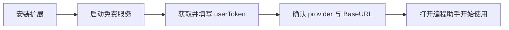

# 快速开始（免费方案完整上手）

FreeSeek 的**核心卖点**：不付费使用 DeepSeek。原理是连接本地运行的
`deepseek-free-api` 逆向服务，把 chat.deepseek.com 的**免费网页对话**转成
OpenAI 兼容接口，零 API 费用。

> ⚠️ 逆向服务依赖 DeepSeek 网页端，可能随官方变动失效，仅供学习自用。
> 需要稳定生产接入时，建议改用官方付费 API（见 [providers.md](providers.md)）。

## 总体流程



## 第 1 步：安装扩展

三种方式任选：

| 方式 | 命令 / 步骤 | 适用场景 |
| --- | --- | --- |
| VS Code Marketplace | 扩展市场搜索 FreeSeek 安装（发布后） | 普通用户 |
| VSIX 手动安装 | `code --install-extension releases/freeseek-copilot-<版本>.vsix` 或扩展面板「从 VSIX 安装…」 | 未发布市场时的分发 |
| 源码运行 | `npm install && npm run compile`，按 F5 调试 | 二次开发 / 内测 |

## 第 2 步：启动免费 DeepSeek 服务

打开命令面板（`Ctrl+Shift+P`）→ 运行 **`FreeSeek: 启动免费 DeepSeek 服务`**，
选择以下任一种启动方式：

### 方式 A：Docker

使用镜像 `vinlic/deepseek-free-api:latest`，一键拉起容器，默认监听
`http://127.0.0.1:8000/v1`。需要本机已安装 Docker。

### 方式 B：Node（推荐，零外部依赖）

免费服务的源码**已随扩展一并打包**（扩展安装目录下的 `deepseek-free-api/`，
即 `jonnyquan/deepseek-free-api` v0.0.17），Node 方式会在该目录直接
`npm install && build && start`，**不依赖任何外部 GitHub 仓库**。

> 上游 `LLM-Red-Team/deepseek-free-api` 与原始上游 `jonnyquan/deepseek-free-api`
> 的 GitHub 页面均已不可公开访问，因此本扩展改为内置源码，从根上规避 404。
> 如你自行更新了该服务源码，可用设置 `freesek.freeApiLocalPath` 指向你的副本
> （如 `E:\timer\deepseek-free\jonnyquan`）。

扩展激活时会自动检测并启动免费服务（设置 `freesek.autoStartFreeServer`，
默认开启）；关闭后需手动通过上述命令启动。

## 第 3 步：获取并填写 `userToken`（关键步骤）

`userToken` 是 chat.deepseek.com 网页端登录后的会话令牌，**不是** DeepSeek
开放平台 API Key。获取方式：

1. 浏览器打开并登录 [chat.deepseek.com](https://chat.deepseek.com)。
2. 按 `F12` 打开开发者工具。
3. 切到 **Application（应用）→ Local Storage（本地存储）→ https://chat.deepseek.com**。
4. 找到名为 `userToken`（或 `user_token`）的键，复制它的值（形如 `eyJhbGciOiJ...` 的长字符串）。
5. 在 VS Code 设置中搜索 **`freesek.freeUserToken`**，把该值粘贴进去。

也可以改为在**服务启动时**设置环境变量：

```bash
# PowerShell
$env:DEEP_SEEK_CHAT_AUTHORIZATION = "<你的 userToken>"

# 或写入启动脚本
DEEP_SEEK_CHAT_AUTHORIZATION=<userToken> npm start
```

FreeSeek 会把该 token 作为 `Authorization: Bearer <userToken>` 头发给本地
`deepseek-free-api` 服务，由该服务转发给 DeepSeek。留空时对话会提示先填写。

## 第 4 步：确认配置

在设置中确认：

- `freesek.provider` = `free`（默认即此；此设置已废弃，仅供旧版兼容）。
- `freesek.freeBaseUrl` = `http://127.0.0.1:8000/v1`（默认即此）。
- `freesek.freeModel` = `deepseek-chat`（可选 `deepseek-reasoner` / `deepseek-v3` 等）。

> 多提供商场景下实际生效的是 `freesek.providers` 中的 `deepseek-free` 项，
> 其 `apiKey` 引用 `${setting:freesek.freeUserToken}`，`toolMode` 为 `react`。
> 详见 [configuration.md](configuration.md)。

## 第 5 步：开始使用

点击侧边栏 **FreeSeek → 编程助手**，描述任务即可。Agent 会自动调用工具
（读文件 / 写文件 / 列目录 / 搜文件 / 搜内容 / 执行命令 / 询问用户），
多步自动迭代、流式输出，并支持深度思考（reasoning）流式展示。

## 常见问题

| 问题 | 处理 |
| --- | --- |
| 对话提示「请先填写 userToken」 | 完成第 3 步，填写 `freesek.freeUserToken` 后重试 |
| 服务启动失败 / 端口占用 | 检查 8000 端口是否被占用；或改 `freesek.freeBaseUrl` 指向其他实例 |
| 报错 401 / 鉴权失败 | 重新从浏览器复制最新的 `userToken`（网页端会话过期会失效） |
| 想要稳定的生产接入 | 改用官方 API，见 [providers.md](providers.md) |
